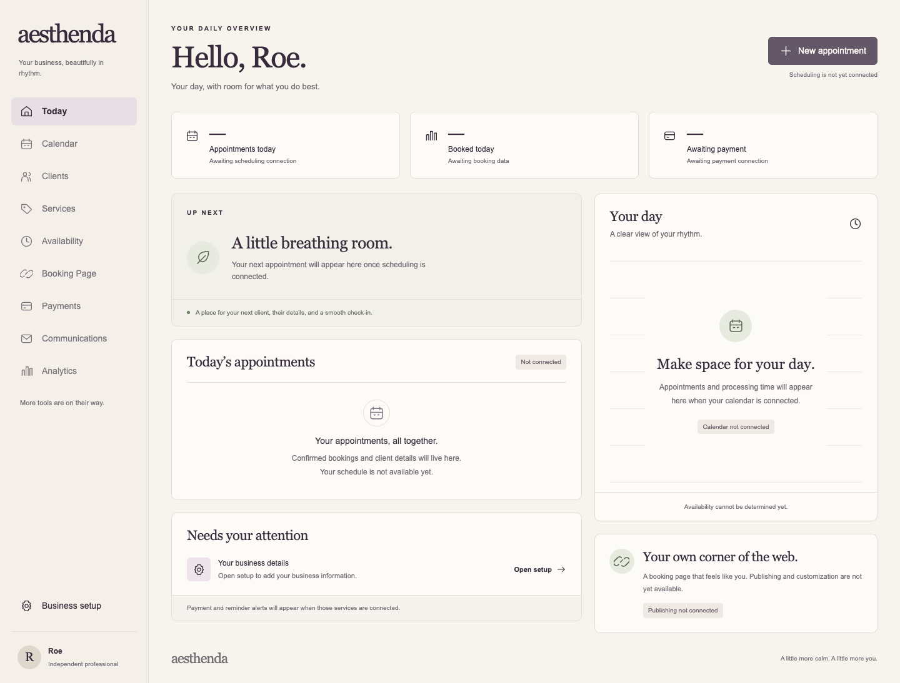

# Dashboard visual concept 01

Date: October 19, 2026
Target: Production Application, `/dashboard`
Status: Frontend visual foundation implemented; business capabilities and deployment remain incomplete.

## Intent and implementation

Implements Roe's requested first dashboard concept using the warm, refined direction developed in the Aesthenda project chat. The layout prioritizes the next appointment, today's appointments, a day overview, and actionable attention items. The prototype remains untouched.

- Scoped dashboard tokens: ivory `#F7F3ED`, aubergine `#382B3C`, sage `#A7B2A0`, paper `#FDFBF8`, and warm borders `#E5DED6`.
- Georgia supplies the display serif; the existing Geist font supplies interface text, with an Arial fallback. No font license or new dependency is required. The image's Canela label is not a licensed font asset or final type decision.
- Responsive sidebar, native expandable mobile navigation, skip link, visible keyboard focus, decorative SVG icons, semantic sections, and loading/error states.
- Verified user metadata may personalize the greeting. It is display-only, escaped by React, and never used for authorization. No invented business name, fake clients, revenue, payment status, publication status, or account-specific date/time is displayed.
- Existing `requireUser()` and middleware remain the authentication boundary. Existing business setup is linked; missing modules have no fabricated routes or enabled commit actions.
- No schema, RLS, authentication, scheduling, payment, or publication contracts change. No live data was accessed or written.

## Current unavailable states

The repository has no connected production dashboard read model for appointments, calendar, payment totals, reminders, or booking publication. Dashes mean unavailable, not zero. The day illustration does not imply bookable availability. Appointment creation is disabled with a visible explanation. The booking card describes publishing as unconnected rather than claiming that the account has no published page. The business setup link does not infer whether an existing business is complete.

## Verification

Local clone; no live Supabase credentials supplied.

- `npm run lint`: passed.
- `npm run build -- --webpack`: passed with non-secret placeholder Supabase URL/key. TypeScript and route generation passed. Existing Next middleware deprecation and Edge runtime warnings remain. Default Turbopack failed because its internal worker could not bind a port in the execution environment; no build-engine setting was changed in the project.
- `node --test tests/auth-session.test.mjs`: 2 passed.
- `TEST_APP_URL=http://127.0.0.1:3187 node --test tests/protected-routes.test.mjs`: 5 passed against the local built app, including signed-out private-route redirects and public sign-in/recovery pages.
- A temporary static render of the actual dashboard component was inspected in headless Chrome at widths 1440, 1024, 768, 390, and 320 px: no horizontal overflow. Mobile menu expansion, keyboard focus progression, existing-route links, and the disabled unavailable scheduling action passed. No mock-auth or public preview route was added to the application.
- Desktop and phone screenshots were visually reviewed. Screenshots use a sample display name and the system sans-serif fallback; deployed interface text uses the existing Geist font.

[Phone dashboard](visuals/dashboard-mobile.png)

## Remaining work and handoff

This is a visual implementation of the unconnected state, not a completed operational dashboard. Bopit/Jefe must provide the authorized account-scoped read/action contracts before real appointments, payment metrics, reminders, scheduling, or publishing are enabled. Tempo owns timing and overlap semantics; do not infer slot availability from this presentation. Skip can then render those trusted results using these visual foundations. Account selection/cardinality, business time zone, and publication status must come from approved contracts rather than frontend assumptions.

Authenticated live-data integration, cross-account isolation of future reads, recovery behavior with real sessions, full assistive-technology validation, populated-state UI, and production deployment have not been verified here. Roe retains final product/visual approval. No deployment, merge, live database change, or production-readiness claim is included.
